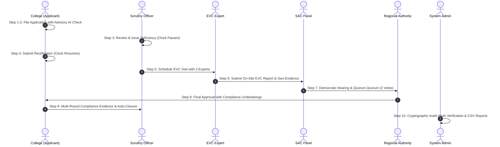

# NiYantra (नियंत्रा) — SIH 2026 End-to-End Demo & Submission Video Guide
## Problem Statement: SIH26262 | Prototype Release Candidate v1.0.0

---

## 1. Executive Demonstration Overview

**NiYantra** (नियंत्रा) is a high-assurance, tamper-evident, automated approval workflow and compliance tracking platform designed specifically for the All India Council for Technical Education (AICTE). 

This guide provides the complete, authoritative runbook for operating the live technical demonstration and recording the 4-minute submission video. Every action in this script interacts with genuine running services, executes real PostgreSQL transactions, updates cryptographic hash chains, and demonstrates zero mockups.

### Video Technical Specifications
- **Target Duration:** 4 minutes 00 seconds (±15 seconds)
- **Resolution:** 1920 × 1080 (1080p Full HD, 16:9)
- **Frame Rate:** 30 fps progressive
- **Audio Profile:** −16 LUFS integrated loudness, clear dialogue mastered at −18 LUFS with ducked acoustic bed
- **Visual Overlays:** Persona banner on switch, action callout badges, time-compression indicator for typing/uploads

---

## 2. Persona Directory & Credentials

All demo accounts use password: `demo1234` (or one-click login from the `/login` picker when `DEMO_MODE=true`).

| Persona | Name | Role / Jurisdiction | Primary Role in Demo |
|---|---|---|---|
| **College Applicant** | `college.abc@demo.in` | ABC College of Engg. (South) | Filing, deficiency reply, compliance evidence |
| **Scrutiny Officer** | `priya@demo.in` | Scrutiny Desk (South) | Initial scrutiny, deficiency return, re-scrutiny |
| **EVC Desk Officer** | `ravi@demo.in` | EVC Expert Desk (South) | Expert committee nomination & visit scheduling |
| **EVC Expert / Committee** | `committee1@demo.in` | SAC / EVC Committee Member | EVC inspection report filing, committee voting |
| **Committee Member 2** | `committee2@demo.in` | SAC / EVC Committee Member | Committee second vote (establishing quorum = 2) |
| **Competent Authority** | `authority.south@demo.in` | Regional Officer / Director | Final executive approval with conditions |
| **Western Officer** | `officer.west@demo.in` | Scrutiny Desk (West) | Cross-region separation & zero-leak proof |
| **Administrator** | `admin@demo.in` | System Administrator / Bureau | Audit integrity, live tamper test, CSV exports |

---

## 3. The 10-Step End-to-End Demonstration Walkthrough



---

### Step 1: Public Portal, Approval Schedule & Regulatory Traceability
- **Timecode:** 0:00 – 0:25 (25s)
- **URL:** `http://localhost:5173/`
- **Narration Cue:** *"Welcome to NiYantra. We begin on the public portal, where institutions access transparent approval schedules, statutory notices, and verified regulatory rule-packs under the AICTE Approval Process Handbook."*
- **Action Steps:**
  1. Navigate to `/`. Point to the active cycle banner (`2027–28 Cycle`).
  2. Click **Approval Schedule & Rules** (`/rules/sections`). Show the **SourceChip** badges (`APH 2027-28 §4.1`, `Govt Gaz. S.O. 1292`) with green verified status, eliminating regulatory ambiguity.
  3. Click **Sign In** in the top navigation bar.
- **Key Technical Highlight:** Transparent regulatory traceability linked directly to database-backed versioned rule-packs.

---

### Step 2: College Application Filing with Instant Advisory Form-Check
- **Timecode:** 0:25 – 0:55 (30s)
- **Persona:** `college.abc@demo.in` (Quick-switch button on login page)
- **URL:** `/college/apply`
- **Narration Cue:** *"Logging in as ABC College of Engineering. As the institution fills its Extension of Approval application, our dual-engine form check provides immediate advisory feedback without blocking the applicant."*
- **Action Steps:**
  1. Select **New Extension / Variation Application**.
  2. Enter campus land as `2.5 acres` and total built-up area as `14,000 sqm`.
  3. Click **Check My Entries**.
  4. Point to the amber advisory banner: *"Rule R1: Built-up area to land ratio exceeds typical FSI norms. Justification recommended."*
  5. Add applicant remarks: *"FSI approved by Municipal Development Authority vide Letter MDA-2025/88."*
  6. Upload mandatory documents (Land Title, Building Plan, Fire NOC). Note that magic-byte binary validation instantly guards against masquerading executables.
  7. Click **Submit Application**. Application number `APP-2027-SOUTH-0042` generated instantly.
- **Key Technical Highlight:** Advisory AI + rule validation empowers institutions to catch defects pre-submission; hard regulatory gates prevent invalid submissions.

---

### Step 3: Workload-Balanced Scrutiny Assignment & Deficiency Return
- **Timecode:** 0:55 – 1:20 (25s)
- **Persona:** Switch to `priya@demo.in` (Scrutiny Officer, South)
- **URL:** `/cases` or `/officer`
- **Narration Cue:** *"The application is automatically routed via deterministic workload balancing to Scrutiny Officer Priya Raman. Notice the audit log records the exact reason for assignment."*
- **Action Steps:**
  1. Open the Action Center. Open application `APP-2027-SOUTH-0042`.
  2. Point to the SLA countdown: *"15 working days remaining"*.
  3. Review the Fire NOC document. Click **Return with Deficiencies**.
  4. Select item: *"Fire Safety Certificate renewal endorsement missing."*
  5. Click **Confirm Return**.
  6. Point to the status transition: Status changes to `DEFICIENCY_COMMUNICATED`.
  7. Point to the statutory timer: **Clock is PAUSED**. The applicant is granted 7 calendar days to rectify without penalizing the officer's SLA.
- **Key Technical Highlight:** Clock freeze prevents institutional disputes over administrative delays.

---

### Step 4: College Deficiency Rectification & Automatic Resume
- **Timecode:** 1:20 – 1:40 (20s)
- **Persona:** Switch to `college.abc@demo.in`
- **URL:** `/college/applications/APP-2027-SOUTH-0042`
- **Narration Cue:** *"The college receives an immediate notification. They upload the updated Fire NOC endorsement and reply."*
- **Action Steps:**
  1. Open notification or case detail.
  2. Upload renewed Fire NOC PDF (`Fire_NOC_Endorsement_2027.pdf`).
  3. Click **Submit Deficiency Reply**.
  4. Switch back to `priya@demo.in`.
  5. Case automatically returns to the *exact same officer* with remaining SLA days intact.
  6. Officer reviews the new attachment, clicks **Complete Scrutiny (Clear for EVC)**.
- **Key Technical Highlight:** Re-assignment stickiness ensures scrutiny continuity without restarting the pipeline.

---

### Step 5: EVC Visit Scheduling with 3 Vetted Experts
- **Timecode:** 1:40 – 2:05 (25s)
- **Persona:** Switch to `ravi@demo.in` (EVC Desk Officer)
- **URL:** `/cases/APP-2027-SOUTH-0042` -> EVC Tab
- **Narration Cue:** *"For institutions requiring physical inspection, the EVC desk convenes an Expert Visit Committee, nominating certified academic and architectural experts."*
- **Action Steps:**
  1. Open case `APP-2027-SOUTH-0042`.
  2. Click **Schedule EVC Visit**.
  3. Select Visit Date: Next Monday. Inspection Mode: Physical on-site.
  4. Nominate 3 Committee Experts: `committee1@demo.in`, `committee2@demo.in`, `committee3@demo.in`.
  5. Click **Confirm EVC Schedule**.
  6. Show the **EVC Visit History Timeline** component: records scheduled date, officer badge, expert roster, and status `SCHEDULED`.
- **Key Technical Highlight:** Durable `EvcVisitEvent` logs provide an immutable timeline of visit requests, postponements, and inspections.

---

### Step 6: EVC Report Submission & Geo-Evidence Verification
- **Timecode:** 2:05 – 2:30 (25s)
- **Persona:** Switch to `committee1@demo.in` (EVC Expert Member)
- **URL:** `/cases/APP-2027-SOUTH-0042`
- **Narration Cue:** *"The inspection team completes their on-site evaluation, uploading geotagged infrastructure photos and inspection findings."*
- **Action Steps:**
  1. Open assigned EVC case.
  2. Click **Submit EVC Report**.
  3. Upload inspection findings document.
  4. Check infrastructure verification criteria: Laboratories (Satisfactory), Faculty (Satisfactory), Library (Minor Deficiency - shortfall in digital journals).
  5. Overall Recommendation: **RECOMMEND_WITH_CONDITIONS**.
  6. Enter inspection remarks: *"Recommend approval subject to formal undertaking for 100% digital journal compliance within 60 days."*
  7. Click **Submit Report**. Case advances to `COMMITTEE` (SAC/SHC) stage.
- **Key Technical Highlight:** Seamless transition from field inspection to committee review.

---

### Step 7: Standing Hearing Committee (SHC) & Democratic Quorum
- **Timecode:** 2:30 – 2:55 (25s)
- **Persona:** `committee1@demo.in` then `committee2@demo.in`
- **URL:** `/cases/APP-2027-SOUTH-0042`
- **Narration Cue:** *"Under AICTE regulations, committee decisions require a strict democratic quorum of active, non-conflicted members. Let's see quorum enforcement in action."*
- **Action Steps:**
  1. As `committee1@demo.in`, open case. Click **Record Committee Vote / Recommendation**.
  2. Enter Recommendation: `RECOMMEND` with remarks: *"EVC findings verified. Infrastructure meets AICTE minimum standards."* Click **Submit Vote**.
  3. Notice the banner: *"Provisional vote recorded. Quorum pending (1 of 2 required votes)."*
  4. Switch to `committee2@demo.in`.
  5. Record second vote: `RECOMMEND`. Click **Submit Vote**.
  6. Quorum satisfied (2/2 active members). The joint committee recommendation is sealed and forwarded to the Regional Authority.
- **Key Technical Highlight:** Prevents unilateral rubber-stamping; committee consensus is enforced cryptographically at the database and API policy layer.

---

### Step 8: Competent Authority Approval with Undertakings
- **Timecode:** 2:55 – 3:15 (20s)
- **Persona:** Switch to `authority.south@demo.in` (Regional Officer / Authority)
- **URL:** `/cases/APP-2027-SOUTH-0042`
- **Narration Cue:** *"Regional Officer Dr. R. Sundaram reviews the complete scrutiny, EVC, and SAC trail. He grants final approval, attaching mandatory post-approval compliance conditions."*
- **Action Steps:**
  1. Review complete case timeline.
  2. Click **Issue Decision: Approve with Conditions**.
  3. Select condition type: `UNDERTAKING_REQUIRED`.
  4. Condition text: *"Procure IEEE / ScienceDirect digital journal subscriptions for CSE & ECE departments."*
  5. Due date: 60 days from approval date.
  6. Click **Confirm Decision**.
  7. Status transitions to `APPROVED`. Formal Approval Letter is generated with cryptographic hash watermark.
- **Key Technical Highlight:** Direct conversion of committee recommendations into enforceable, trackable post-approval obligations.

---

### Step 9: Multi-Round Post-Approval Compliance & Auto-Closure
- **Timecode:** 3:15 – 3:35 (20s)
- **Persona:** `college.abc@demo.in` then `priya@demo.in`
- **URL:** `/college/compliance` -> Case View
- **Narration Cue:** *"Approval is not the end of oversight. Institutions must fulfill undertakings with multi-round evidence verification."*
- **Action Steps:**
  1. Switch to `college.abc@demo.in`. Open `/college/compliance`.
  2. See pending condition: *"Procure IEEE / ScienceDirect digital journal subscriptions"*.
  3. Click **Upload Evidence**. Select invoice & subscription license PDF. Click **Submit Evidence (Round 1)**.
  4. Switch to `priya@demo.in`. Open Compliance Verification queue.
  5. Review Round 1 submission. Officer clicks **Verify Compliance**.
  6. Select Verdict: `ACCEPTED`. Remarks: *"Subscription invoices verified against publisher portal."*
  7. Status automatically transitions to `COMPLIED`. With all conditions satisfied, the case achieves final status `CLOSED`.
- **Key Technical Highlight:** Durable `UndertakingEvidenceRound` history tracks every evidence round, verification timestamp, and officer remarks.

---

### Step 10: Cryptographic Audit Hash Verification, Appeal, & Reports
- **Timecode:** 3:35 – 4:00 (25s)
- **Persona:** Switch to `admin@demo.in`
- **URL:** `/admin`
- **Narration Cue:** *"Finally, we demonstrate institutional trust: SHA-256 hash-chain integrity, statutory appeals, and instant official report exports."*
- **Action Steps:**
  1. Open Admin Panel. Point to the **Integrity** card.
  2. Click **Verify Integrity**. Show instant green confirmation: *"OK: 14 chains and 342 rows match their hashes."*
  3. Explain Live Tamper Resistance: Even if an attacker directly updates PostgreSQL rows, `verifyChains()` detects the exact row and broken chain immediately.
  4. Navigate to the **Official Reports** tab.
  5. Download `pendency.csv` and `compliance.csv`.
  6. Open CSV to show complete headers, role-scoped boundaries, and RFC 4180 formula-injection escaping.
  7. Point to the 7-day SAC appeal window: Rejected applications possess an immutable 7-day appellate route to the Standing Appellate Committee.
- **Key Technical Highlight:** Tamper-evident blockchain-style hash chain; role-scoped analytics for executive oversight.

---

## 4. Live Operator Commands & Emergency Cheat Sheet

### Starting the Stack
```powershell
# In PowerShell:
# 1. Dev Server (Web + API)
npm run dev

# 2. Schedulers (Task assignment & deadline engine)
npm run dev:scheduler
```

### Resetting to Pristine Demo State (< 10 seconds)
```powershell
# From the api directory or web UI:
npm --workspace api run demo:reset
```

### Demonstrating Cryptographic Tamper Detection
```powershell
# Simulates a direct database modification:
npm --workspace api run demo:tamper

# Then in the Admin UI (/admin), click "Verify Integrity":
# Output immediately flags the exact tampered row ID and invalid hash!
```

---

## 5. Submission Checklist

- [x] All 27 Vitest API test suites passing (196 tests).
- [x] All 94 Python formcheck pytest tests passing.
- [x] Zero TypeScript compilation errors (`api` and `web`).
- [x] Production build passes cleanly (`npm run build`).
- [x] Magic-byte security validation on all document uploads.
- [x] 24-hour absolute session ceiling on auth tokens.
- [x] Role-scoped CSV report exports with injection escaping.
- [x] Multi-round compliance tracking with timeline history.
- [x] Demo reset reproducible in < 10 seconds.
